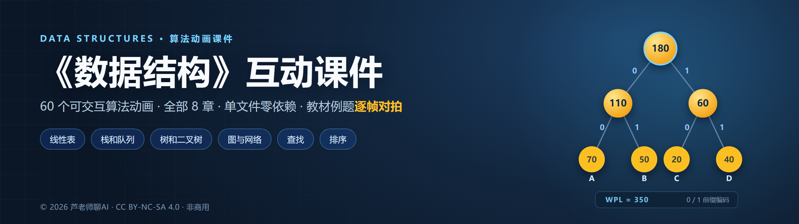
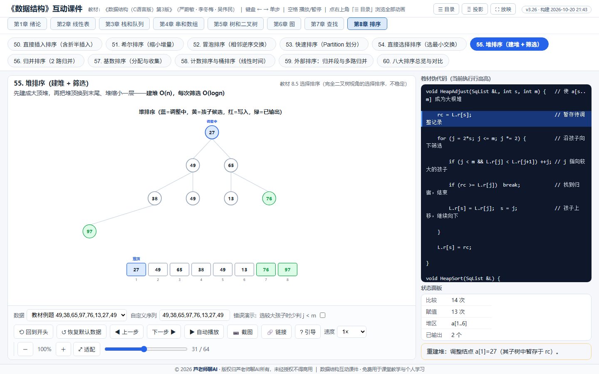
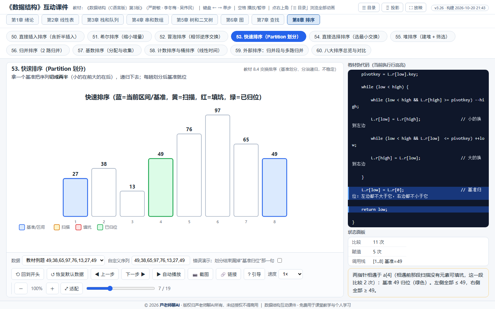
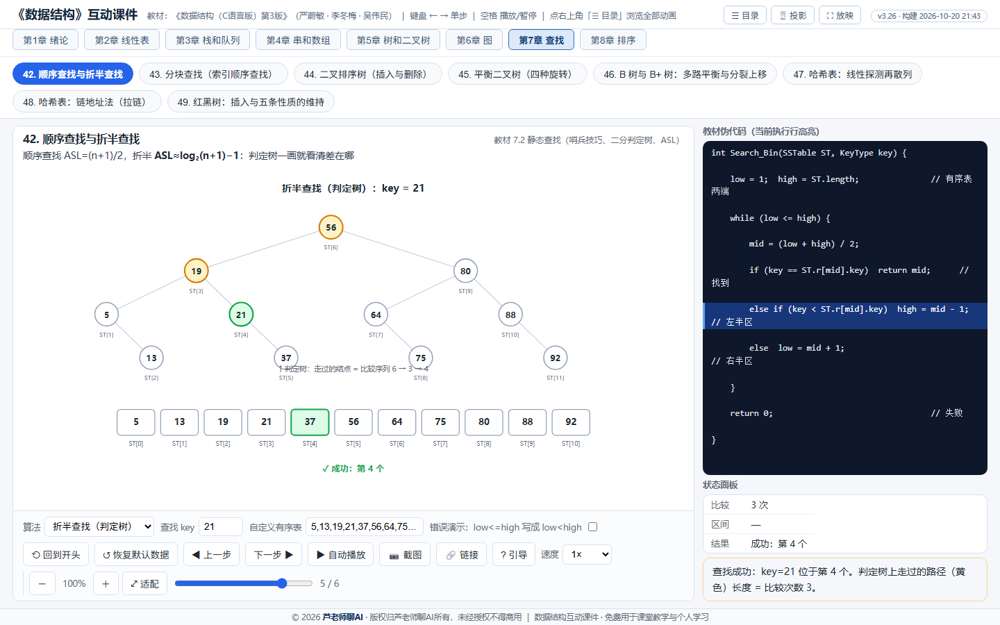
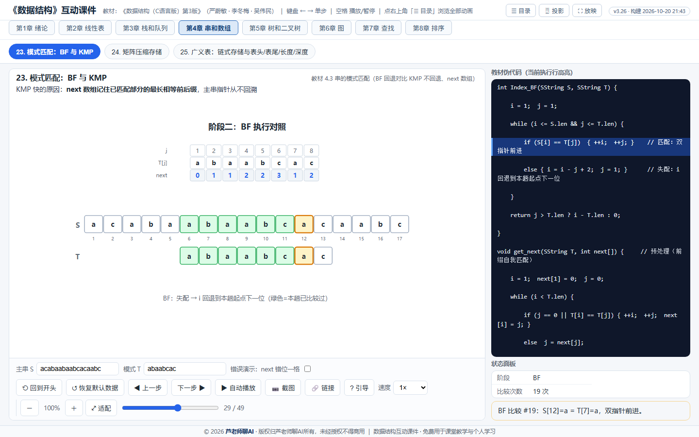
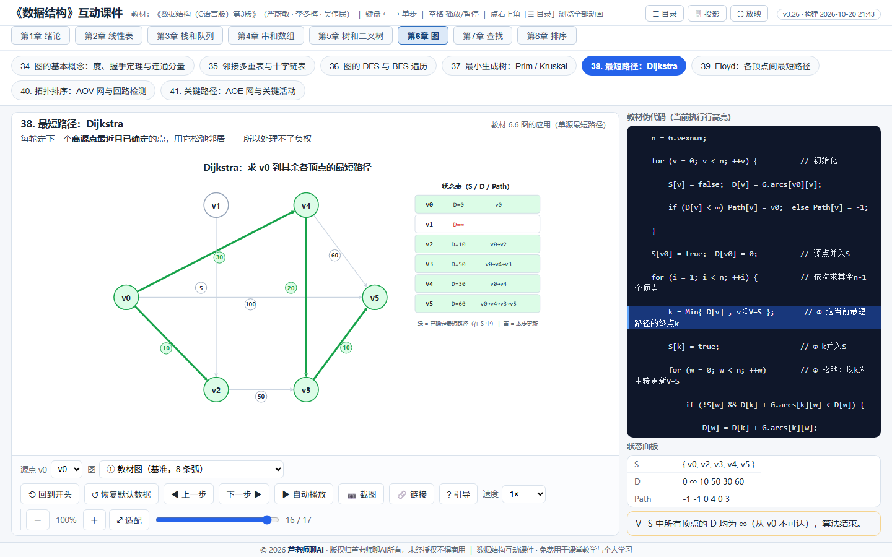
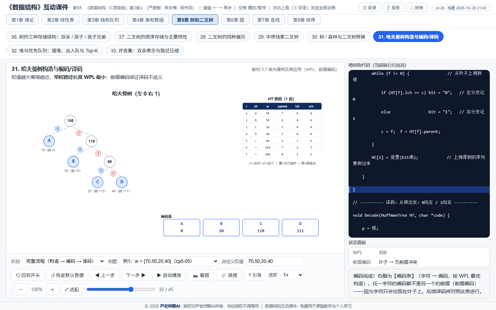
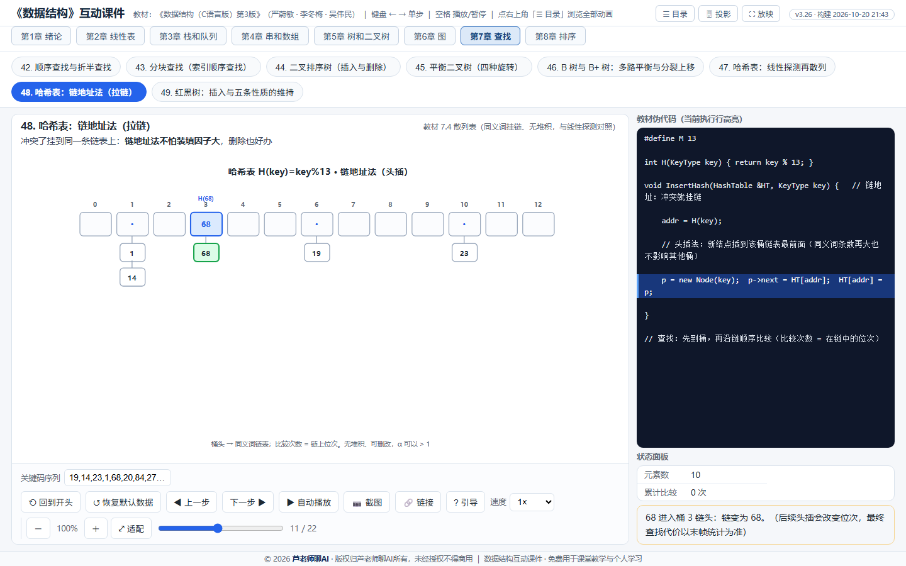
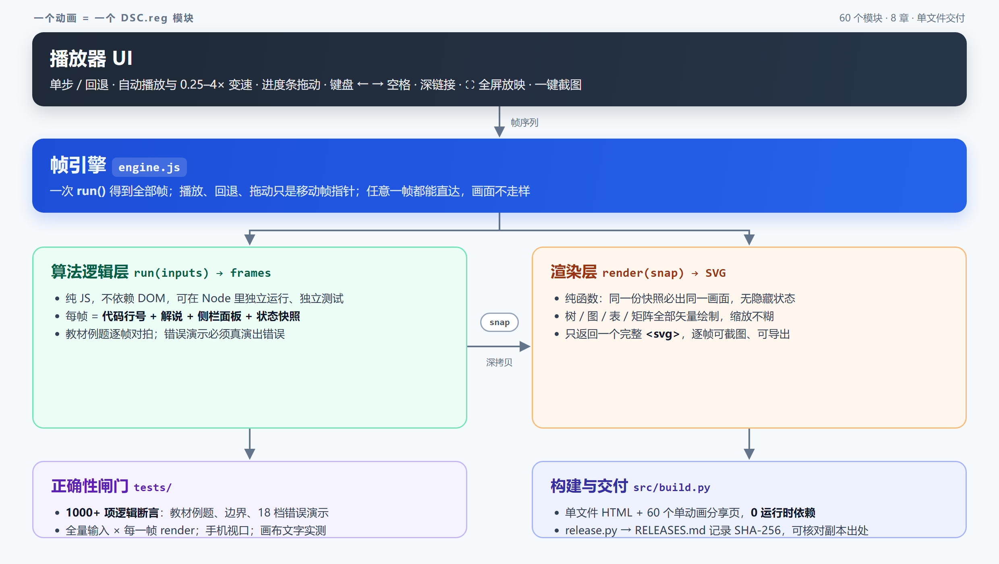

<div align="center">
  

        

  **[▶ 在线打开](https://ch1209498273.github.io/ds-animations/)** ｜ **[⬇ 下载单文件 zip](https://github.com/ch1209498273/ds-animations/raw/main/ds-animations-v3.26.zip)** ｜ **[配套手册 PDF](https://github.com/ch1209498273/ds-animations/raw/main/ds-handbook-v3.26.pdf)** ｜ **[单动画示例](https://ch1209498273.github.io/ds-animations/a/heapSort.html)**

  © 2026 **芦老师聊AI** · [CC BY-NC-SA 4.0](LICENSE)（非商用）
</div>

<p align="center">
  <strong>算法不是画出来的，是跑出来的。</strong><br>
  60 个数据结构算法动画 · 全部 8 章 · 单文件零依赖 · 课堂投影 / 手机 / 断网都能用
</p>

<p align="center"><sub>Interactive Data Structures courseware: 60 algorithm animations, single-file, zero runtime dependencies.</sub></p>

---

## 先看 30 秒

<div align="center"></div>

哈夫曼树：构造（森林逐轮合并）→ 编码（叶→根收集 0/1，显式逆置 + 读树验证）→ 译码（报文 `100110111` → `BACD`）。画面里的每一帧都是算法真实执行出来的状态，不是手绘动画；可以随时暂停、回退、拖到任意一帧。

[▶ 打开这个动画](https://ch1209498273.github.io/ds-animations/#m=huffman) ｜ [看第 29 帧的编码表](https://ch1209498273.github.io/ds-animations/#m=huffman&f=29) ｜ [单独分享这一页](https://ch1209498273.github.io/ds-animations/a/huffman.html)

## 为什么不是"又一个动画网页"

- **真的在跑算法**：每个动画都是把算法真实执行一遍、逐步记录状态，再按帧播放；不是先画好 Gif 再配音。画面里的比较次数、指针、堆区、D 表都是当场算出来的。
- **正例 + 反例**：18 档错误演示——链表先断后连、把 `>` 写成 `>=`、把 `low<=high` 写成 `low<high`……每一档都必须真的演出可观察的后果，由发布前的自动检查逐档核对，不是只换个红字。
- **为课堂投影设计**：单屏不滚动、教材伪代码随执行高亮、自动播放按解说长度定帧、「第 N 趟/轮」边界多停一拍；放映中按 `C` 直接切换动画，`PageDown`/`PageUp` 按节拍跳转。
- **断网也能用**：一个约 650 KB 的 HTML 文件，双击就开，不装环境、不联网。教室机、U 盘、离线机房都能跑。
- **手机也能看**：≤700px 独立布局，可点元素全部 ≥44px；手机放映只留画面，左右缘 ‹ › 翻页，竖屏进入自动转横屏。
- **分享到某一帧**：60 个单动画页（约 80–120 KB）+ 二维码 + `#m=模块&f=帧号` 深链接。发给学生就停在你要讲的那一步，也可以 iframe 嵌进作业页。

<details>
<summary><b>完整操作与无障碍细节</b></summary>

- 单步 / 回退 / 自动播放 / 0.25–4× 变速 / 进度条任意拖动 / 键盘 ← → 空格 Home End
- 画面缩放平移（`Ctrl`+滚轮、触屏捏合、双击放大）、`⋯ 更多` 展开完整操作台
- 一键截图（自动带版权水印）、☰ 总目录直达、每个动画可复制深链接或二维码
- 解说区 `aria-live` 播报、动画图 `role="img"`、进度条可标注；放映态解说控制在三行、150 字以内，超长会被裁掉，所以发布前的自动检查会逐帧查
- 手机端：单指横滑翻页、双指捏合缩放、双击放大看标注；`&mp=1` 深链可直接进入手机放映

</details>

## 三种用法

| 场景 | 怎么用 | 入口 |
|---|---|---|
| **在线看 / 课堂临时用** | 打开网页点开即用；右上角 `☰` 按章浏览，放映中按 `C` 切动画 | [ch1209498273.github.io/ds-animations](https://ch1209498273.github.io/ds-animations/) |
| **教室机 / 断网 / 拷 U 盘** | 下载单文件 zip，解压双击 `数据结构互动课件.html`，不联网不装环境 | [ds-animations-v3.26.zip](https://github.com/ch1209498273/ds-animations/raw/main/ds-animations-v3.26.zip) |
| **只分享一个动画 / 嵌作业** | 60 个独立单页，也可以复制任意一帧的深链接或 iframe | [单动画示例](https://ch1209498273.github.io/ds-animations/a/heapSort.html) |
| **备课 / 学生自学** | 38 节 · 121 页 A4 · 59 幅与课件同源的插图，可独立阅读 | [ds-handbook-v3.26.pdf](https://github.com/ch1209498273/ds-animations/raw/main/ds-handbook-v3.26.pdf) |

**配套知识点手册**：正文按教材小节编，每节带定义/方法/手工演算/例题/易错点/习题，答案集中在附录。手册版本与课件版本对齐——59 幅插图逐字取自课件 v3.26 的同一套画面，每幅都显式钉住宿主场景与帧号，不随默认档改动而换画面；题注取那一帧自己的解说，所以画面与题注不会各说各话。**v3.26 没有改手册正文；本版钉住的插图与题注和 v3.25 版逐字相同（插图变动发生在 v3.24–v3.26 三轮，共 14 幅）。**

<details>
<summary>手册与课件的版本对齐说明（v3.26）</summary>

课件 v3.24–v3.26 三轮里 **14 幅**插图的画面变了（含希尔 35→43、归并 24→39 两幅随帧号重钉）。v3.26 只改放映态解说文案，**没有一处落在被钉住的那几帧上，所以本版题注与画面和上一版逐字相同**。8.7 的实测表与 8.5 基数排序趟数在 v3.23 那轮已与课件对齐（直接插入 27/25、希尔 35/27），本版沿用。旧版 PDF 仍保留原地址，不破坏已有链接。

</details>

<details>
<summary><b>复制 iframe 嵌入代码</b></summary>

```html
<iframe src="https://ch1209498273.github.io/ds-animations/#m=heapSort&f=30"
        width="960" height="620" style="border:0"></iframe>
```

把 `#m=` 后面的模块 id 和 `f=` 后面的帧号换成你要讲的那一步即可；目录里的「链接」按钮会直接给你当前帧的深链接。

</details>

## 截图选览

点击图片下方的「直达」链接可跳到**线上课件的同一步**：

| | |
|---|---|
| <br>**堆排序**：完全二叉树 + 数组双视图联动，建堆/筛选逐帧 · [直达](https://ch1209498273.github.io/ds-animations/#m=heapSort&f=30) | <br>**快速排序**：Partition 双指针填坑 + 递归调用栈 · [直达](https://ch1209498273.github.io/ds-animations/#m=quickSort&f=6) |
| <br>**折半查找**：判定树随比较路径点亮，ASL 可验 · [直达](https://ch1209498273.github.io/ds-animations/#m=seqBinSearch&mode=bin&key=21&f=4) | <br>**八大排序总览**：同一数据 × 8 算法 × 代价对照 · [直达](https://ch1209498273.github.io/ds-animations/#m=sortGallery&f=8) |
| <br>**模式匹配 BF/KMP**：next 逐格计算，主串指针不回退对照 · [直达](https://ch1209498273.github.io/ds-animations/#m=kmp&f=28) | <br>**Dijkstra 最短路径**：图、状态表、伪代码三方联动 · [直达](https://ch1209498273.github.io/ds-animations/#m=dijkstra&f=15) |
| <br>**哈夫曼树**：树 + HT 数组同步，WPL=350 可验 · [直达](https://ch1209498273.github.io/ds-animations/#m=huffman&f=29) | <br>**哈希表·链地址**：同余挂链，与线性探测 ASL 对照 · [直达](https://ch1209498273.github.io/ds-animations/#m=hashChain&f=10) |

## 60 个动画目录

下面的顺序 = **教材小节顺序**（v3.0 起；v3.2 把第 3、5、6、8 章也补齐了），不是开发顺序。站内序号按目录顺序自动生成，加一个动画后面全部顺延；要序号看页面右上角 `☰` 目录，那里也能复制任意一步的深链接。

<details>
<summary><b>展开全部 60 个动画（按章）</b></summary>

- **第1章 绪论**：**数据结构基本概念**（四种逻辑结构 · 顺序/链式存储 · ADT 三元组） · 时间复杂度可视化（六阶增长曲线） · **空间复杂度**（辅助空间与递归栈、原地算法） · **怎么算时间复杂度**（四步法 + O(log₂n) 怎么来）
- **第2章 线性表**：顺序表插入/删除 · 顺序表基本操作合集 · 单链表插入/删除 · 链表基本操作合集 · 双向/循环链表 · 合并有序表 · 一元多项式相加 · **链表三道经典题**（就地逆置、约瑟夫环、找公共结点）
- **第3章 栈和队列**：顺序栈 · 链栈与链队列（rear 的"最后一个结点"特判） · 递归调用栈·汉诺塔 · 假溢出与循环队列（四方案） · 括号匹配 · 表达式求值（双栈法） · **中缀转后缀与后缀求值** · 数制转换 · 迷宫求解
- **第4章 串和数组**：模式匹配 BF/KMP（next 数组） · 矩阵压缩存储（对称映射 + 快速转置） · **广义表**（三域结点、表头/表尾/长度/深度）
- **第5章 树和二叉树**：**树的三种存储结构**（双亲/孩子/孩子兄弟） · **二叉树的顺序存储与主要特性** · 四种遍历 · 中序线索二叉树 · 树/森林与二叉树转换 · 哈夫曼树与编码/译码 · **优先队列与堆**（建堆下沉、动态插入、Top-K） · 并查集（按大小合并 + 路径压缩）
- **第6章 图**：**图的基本概念**（无向度/握手定理、有向入出度、连通分量、强连通分量，四场景可自定义边表） · **邻接多重表与十字链表** · DFS/BFS · **Prim/Kruskal 最小生成树**（五张预置图各答一个问题：并列权时树不唯一、稀疏图零丢弃、K5 必须判环） · **Dijkstra**（同样五张图：并列最短路只记一条、同一个点的 D 被改三次、非连通留两个 ∞、负权反例） · **Floyd**（四张图：负权图算出 Dijkstra 算错的 0、有负环时对角线自己变负、不连通留一串 ∞；再把 k 挪到最内层就会算错） · **拓扑排序**（四张图报出合法序列各有几个：基准 22、一条链 1、有回路 0、两个自由点 30；只弹点不删弧就会误判有环） · 关键路径
- **第7章 查找**：顺序/折半查找（判定树 + ASL） · 分块查找 · 二叉排序树 · AVL 四种旋转 · **B 树与 B+ 树**（插入分裂、查找路径、**删除的借位与合并**、B+ 叶子链表） · 哈希·线性探测 · 哈希·链地址 · **红黑树**（插入 + 五条性质逐帧重算）
- **第8章 排序**：直接插入（含折半） · 希尔 · 冒泡 · 快速 · 直接选择 · 堆排序 · 归并 · 基数 · **计数排序与桶排序**（不比大小的线性时间排序） · **外部排序**（归并段生成、置换-选择、⌈log_k m⌉ 趟） · 八大排序总览对比（本章收尾）

</details>

> 第 2、3、4、5、7、8 章的多数模块支持**自定义数据**（改权值、改表达式、换存储结构、随机/有序/逆序/几乎有序预设），课堂上可以现场出题现场演；第 6 章里**图的基本概念与邻接多重表/十字链表可自定义边表**，其余 6 个（DFS/BFS、生成树、最短路、拓扑、关键路径）目前只能切预设图，自定义图已排期。

## 它是怎么做到的

<div align="center"><a href="assets/arch.png"></a></div>

- **算法先跑一遍，播放只是移动指针。** 每个动画先把算法真实执行完，逐步记录状态快照；播放、回退、拖动进度条、深链接跳帧都只是移动指针。同一帧永远画出同一画面，回退到第 3 步和第一次播放到第 3 步逐字节相同。
- **一份内容，两种产物。** 全部样式、引擎与 60 个动画内联成一个约 650 KB 的 HTML；另有 60 个约 80–120 KB 的单动画页。没有框架、没有打包器、没有 CDN，不加载外部资源、不发网络请求、不写 cookie/localStorage。
- **每一帧都可寻址。** `#m=模块&f=帧号` 直接定位到课堂那一步；配合 60 个单页、二维码和 iframe，发给学生就停在你要讲的位置。
- **为投影做减法。** 单屏不滚动、伪代码随执行高亮、自动播放按解说长度定节拍、「第 N 趟/轮」边界多停一拍；手机端另有一套 44px 可点元素的布局。

## 质量与验证

正确性不是"看起来对"。每个版本发布前都要过三段自动卡口：**1003 项正确性断言 + 119 项手机视口卡口 + 7 项画布文字实测**，必须保证 1129 项全绿；再加一轮 **63 项全量功能实测**，348 组输入、8,475 帧全部渲染过。

<details>
<summary><b>这些数字查的是什么</b></summary>

- **教材对拍**：排序每一趟结果、KMP 的 next 数组、B 树/B+ 树结构不变式、Dijkstra 的 D 表、Prim/Kruskal 总权值、关键路径工期……逐项对照教材/PPT 例题。
- **错误演示必须真出错**：18 档错法逐档核对"真的演出可观察的后果"，不是换个红字。比如把 `>` 写成 `>=`，序列仍然有序，但稳定性没了。
- **手机与投影**：390×844 / 844×390 无横溢、可点元素 ≥44px、画布文字真实宽度不越出边界、放映态解说 ≤150 字。
- **数字不手写**：断言数、输入组数、帧数由发布脚本从实跑结果回填。

合起来是 **1003 项断言**（外加 119 项手机视口/放映实测 + 7 项画布文字实测）。

</details>

## 常见问题

**Q：github.io 打不开 / 很慢？**
国内访问 GitHub Pages 不稳定。下载 zip（[仓库内直链](https://github.com/ch1209498273/ds-animations/raw/main/ds-animations-v3.26.zip)），解压双击打开，体验完全一致。

**Q：手机上能用吗？**
能用，推荐 **⛶ 手机放映**：只留画面，左右缘 ‹ › 箭头翻页，画面严格铺满窗口不用拖动，竖屏进入自动转成横屏，右上角 ✕ 退出，`&mp=1` 深链可分享。
注意画布是 980 单位宽的横宽比，**竖屏下宽度只有 390px，字必然只有 5~7px**——这不是没做适配，是几何决定的，请用横屏或双击放大。

**Q：不是这个教材/学校能用吗？**
可以。界面只对齐《数据结构（C语言版）》通用章节体系（严蔚敏经典八章），不绑定任何学校；两套教材章节编号兼容。站内动画顺序 = 教材小节顺序（v3.0 起）。

**Q：怎么给学生的作业里嵌入某个动画？**
iframe 引用在线地址即可（示例见上面的「复制 iframe 嵌入代码」），目录页可一键复制任意动画的深链接。

**Q：能改成自己的例题吗？**
第 2、3、4、5、7、8 章的多数模块支持自定义数据/表达式/存储结构；第 6 章的图模块目前是预设图，自定义图已排期。需要校本定制或二次开发，联系作者。

**Q：源码开放吗？**
公开仓库只发布可运行的课件成品与配套文档。完整源码不在公开仓库提供，避免被整体搬运、换壳或二次售卖；课堂教学、备课、学生自学都不受影响。需要二次开发、校本定制或商业授权，联系 **1209498273@qq.com**。

## 反馈与支持

- 发现演示错误、文字错误 → [提 Issue](../../issues/new?template=bug_report.md)
- 想要新动画（红黑树、B 树删除、串的其他算法等）→ [动画许愿](../../issues/new?template=feature_request.md)
- 文档与演示问题欢迎 Issue；**不接收代码 PR**（源码不公开）
- 如果这个课件帮到了你的课堂，点个 ⭐ Star，或转给正在教/学数据结构的同事
- 商用 / 定制 / 合作 → **1209498273@qq.com**

## 源码与授权

- 课件成品（在线版、单文件 zip、60 个单页、配套手册）以 [CC BY-NC-SA 4.0](LICENSE) 授权：**署名 · 非商业 · 相同方式共享**，请勿商用。
- **完整源码不公开**，公开仓库只保留成品与文档。需要二次开发或商业授权，请联系作者。
- 核对一份副本是不是本仓库的产物：`python tools/verify_rights.py 那份.html`。不带私钥时能验完整性（改一个字节就对不上），带私钥时能验出处。
- 例题与术语对齐《数据结构（C语言版）第3版》（严蔚敏、李冬梅、吴伟民，人民邮电出版社），仅作教学对齐用途。
- 版本历史：[CHANGELOG.md](CHANGELOG.md) · [RELEASES.md](RELEASES.md)（每次发版记录主文件 SHA-256，可核对副本出处）。
